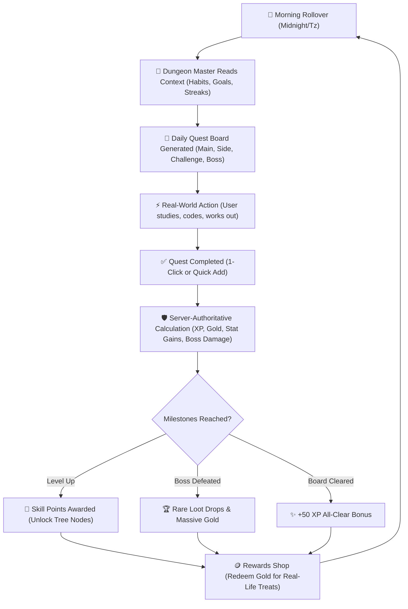
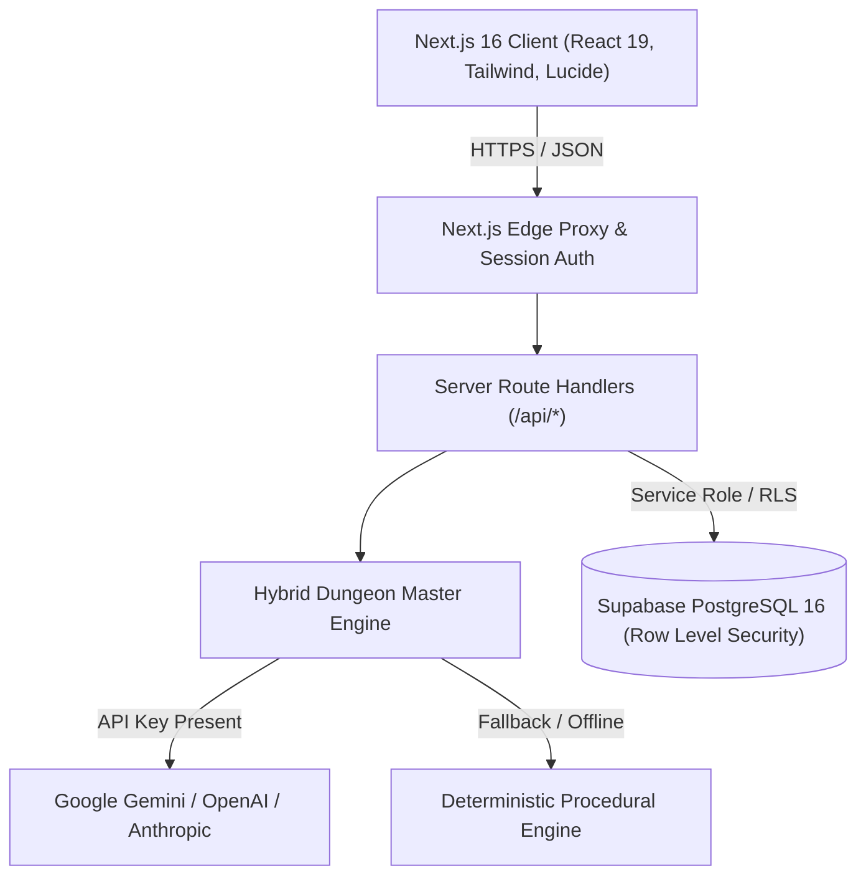
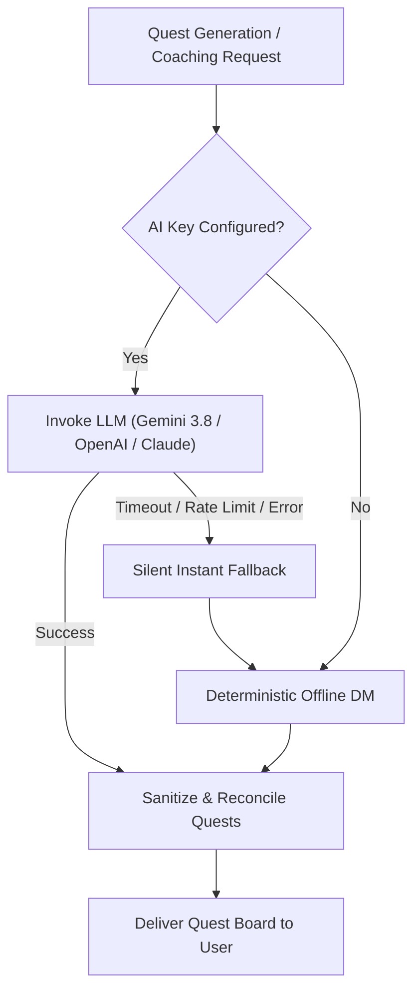

# Phoenix OS: The Complete Architectural & Functional Guide
*“Your life is the game. Your AI is the Dungeon Master.”*

---

## 1. Executive Summary & Vision

**Phoenix OS** is an autonomous, full-stack personal development operating system and life RPG. It bridges behavioral psychology, task management, and tabletop RPG mechanics into a unified, server-authoritative web platform.

### The Fundamental Philosophy
Traditional productivity tools (Notion, Todoist, Apple Reminders, Trello) are passive chore lists. They track tasks until users suffer burnout, guilt, or boredom. 

Phoenix OS changes the paradigm:
1. **You are the Main Character**: Real-world tasks (coding, studying, workouts, hydration, deep work) are converted into **Quests**, **Boss Battles**, and **Skill Points**.
2. **AI is the Dungeon Master (DM)**: An integrated AI engine assesses your goals, active habits, performance streaks, and fatigue levels each morning to write an engaging, narrative-driven quest board.
3. **Server-Authoritative Anti-Cheat**: Unlike simple local storage games, combat damage, level rollovers, gold payouts, and streak penalties are computed server-side in PostgreSQL using cryptographic-grade validation.
4. **Tangible Real-World Economy**: Gold earned from finishing tasks is redeemed for actual real-world treats (movies, games, dinner, guilt-free relaxation) at prices set by the user.

---

## 2. Problem Statement & Real-World Use Cases

### The Problem
* **Procrastination & Dopamine Mismatch**: High-value tasks (e.g., studying data structures, writing thesis chapters, exercising) provide delayed gratification weeks or months later. Social media and gaming provide instant micro-dopamine. 
* **Failure of Static Habit Trackers**: Generic habit apps lack contextual adaptability. If a user has a heavy exam day, a rigid habit tracker punishes them equally for missing a workout.
* **Lack of Narrative Context**: Tasks feel isolated. There is no overarching story tying together daily chores.

### Real-World Use Cases & Personas

| Persona | Real-Life Challenge | Phoenix OS Use Case |
| :--- | :--- | :--- |
| **B.Tech CSE / IT Student** | Preparing for technical campus placements while managing semester coursework and avoiding burnout. | **Placement Campaign**: DSA problems become **Main Quests**; mock interviews become **Boss Battles**; system design practice boosts the `coding_skill` & `intelligence` attributes. |
| **Software Engineer / Indie Hacker** | Managing feature shipping, debugging legacy code, refactoring, and maintaining health. | **Startup Founder Campaign**: High-impact tickets become **Critical Quests**; clearing technical debt unlocks the **Artificer** skill tree and awards Gold for weekend trips. |
| **Fitness / Wellness Athlete** | Maintaining workout consistency, hydration, clean nutrition, and recovery. | **Iron & Soul Campaign**: Lifting sessions, 10k steps, and 2L hydration feed `strength` and `health` stats; rest days leverage **Streak Freezes** without breaking momentum. |
| **Competitive Exam Aspirant (UPSC / GATE / GRE)** | Facing solitary 12-month study schedules with overwhelming syllabi and zero immediate feedback. | **Scholar / UPSC Campaign**: Daily chapters unlock episodic lore chapters; weekly AI performance reviews diagnose weak study areas and suggest syllabus pacing. |
| **ADHD / Overwhelmed Individual** | Task paralysis caused by staring at 50 unordered tasks. | **Gentle Difficulty Board**: The AI curates a constrained 4-quest board, removing decision fatigue and providing clear visual/audio feedback on completion. |

---

## 3. The Core Game Loop (Step-by-Step)



### 1. Morning Rollover & Briefing
When a user opens Phoenix OS in their local timezone:
- The system checks if today's board has been created.
- The **AI Dungeon Master** synthesizes the user's active goals, scheduled habits, historical streak, and campaign lore.
- It writes a personalized **Daily Narrative Dispatch** and creates tailored quests.

### 2. Quest Engagement
The user is presented with their board:
- **Main Quests (70 XP)**: High-leverage priority tasks (e.g., "Build Auth Module").
- **Side Quests (30 XP)**: Supporting actions (e.g., "Read 20 pages").
- **Daily Challenges (25 XP)**: Focus sprints (e.g., "45 minutes uninterrupted execution").
- **Boss Battles (150+ XP)**: Multi-day milestones where every completed quest deals damage to the boss's HP bar.

### 3. Real-Time Feedback
Completing a task triggers:
- Synthesized Web Audio chimes (no heavy MP3s).
- Dynamic screen confetti and floating stat toasts.
- Incremental boss damage.
- Progression toward guild milestones.

---

## 4. Comprehensive Gameplay Mechanics

### 4.1 The 10 Character Attributes
Every character is defined by 10 core real-world attributes:

```
[STRENGTH]       Physical power, gym workouts, resistance training.
[INTELLIGENCE]   Logical reasoning, system design, technical learning.
[WISDOM]         Reading, mindfulness, reflection, long-term decision making.
[DISCIPLINE]     Consistency, waking early, sticking to routines.
[CHARISMA]       Networking, leadership, public speaking, team management.
[HEALTH]         Sleep quality, cardio, hydration, nutrition.
[CREATIVITY]     Art, creative writing, innovative problem-solving.
[CODING_SKILL]   Programming speed, clean code, algorithmic mastery.
[COMMUNICATION]  Presentations, written clarity, active listening.
[FINANCE]        Budgeting, investing, financial audits.
```

### 4.2 The 7 Character Classes

1. **Artificer**: Builder of systems. Leans on `intelligence` & `coding_skill`. Gains crafting bonuses and XP boosts for technical builds.
2. **Guardian**: The unshakeable pillar. Leans on `discipline` & `health`. Features enhanced streak freeze recovery.
3. **Scholar**: Master of knowledge. Leans on `intelligence` & `wisdom`. Excels at multi-hour study sprints.
4. **Striker**: High-energy athletic warrior. Leans on `strength` & `discipline`. Extra damage in boss battles.
5. **Diplomat**: Master communicator. Leans on `charisma` & `communication`. Multiplies guild and duel earnings.
6. **Strategist**: Long-term planner. Leans on `wisdom` & `finance`. High bonuses for timely task completion.
7. **Adventurer**: Balanced hybrid. Equal distribution across all core stats; ideal for beginners.

### 4.3 Combat Math & Anti-Cheat Progression

The progression system is mathematically modeled to prevent inflation while sustaining engagement for months:

* **Level Progression Formula**:
  $$\text{XP Required for Level } L = \text{round}\left(100 \times L^{1.5}\right)$$
  - Level 1 $\rightarrow$ 2: 100 XP
  - Level 5 $\rightarrow$ 6: ~1,118 XP
  - Level 10 $\rightarrow$ 11: ~3,162 XP
  - Level 25: ~12,500 XP (~8 months of dedicated daily consistency).

* **Boss Combat Damage**:
  $$\text{Damage} = \text{Base XP} \times \text{Quest Multiplier} \times (1 + \text{Gear Bonus})$$
  Boss fight quests deliver $2.5\times$ base damage.

* **Server-Authoritative Anti-Cheat**:
  All progress calculations occur inside database transactions or secure API endpoints (`/api/quests/complete`). The client only sends `{ questId }`. The server validates timestamps, idempotency gates, player ownership, and calculates final numbers.

---

## 5. Technical Architecture & Stack



### Frontend Architecture
- **Framework**: **Next.js 16.4.3** with **Turbopack** and App Router.
- **UI Library**: **React 19** with Server Components (`RSC`) and selective Client Components (`'use client'`).
- **Styling**: **Tailwind CSS 3.4** utilizing custom design tokens (Arcane violet, Gold, Ember, Sage, Parchment, Ink).
- **Sound Engine**: Procedural Web Audio API sound synthesis in `lib/audio/sfx.ts` generating retro 8-bit / 16-bit square and triangle wave chimes dynamically with zero network latency.

### Backend & API
- **Runtime**: Next.js Node.js server environment with isolated API wrapper (`lib/server/api.ts`).
- **Validation**: Strict schema validation via **Zod 4.6**.
- **Security**: Strict CSRF origin verification, HTTP-only secure cookies, and non-bypassable player verification.

### Database (PostgreSQL 16 via Supabase)
- **Row-Level Security (RLS)**: Enforced across all player tables (`characters`, `character_stats`, `quests`, `goals`, `habits`, `guilds`).
- **Database Triggers & Stored Procedures**:
  - `handle_new_user()`: Automatically provisions profiles on auth sign-up.
  - `damage_boss(p_boss, p_damage)`: Atomic boss damage calculation preventing race conditions.
  - `bump_guild_quest(p_guild, p_amount)`: Atomic guild contribution counter.

---

## 6. The AI Dungeon Master Engine

Phoenix OS features a **Resilient Hybrid AI Engine**:



1. **Auto-Upgrading Hybrid Architecture**:
   - If an API key is provided (`GEMINI_API_KEY`, `OPENAI_API_KEY`, or `ANTHROPIC_API_KEY`), the app uses the state-of-the-art LLM.
   - If no key is set, or if an LLM call fails, times out, or gets rate-limited, the system **silently falls back to the deterministic procedural engine** in `lib/ai/offline.ts`.
   - **Zero downtime guarantee**: The user never sees an error screen because of an external AI outage.

2. **AI Capabilities**:
   - **Daily Briefing**: Contextual narrative reflecting recent wins, overdue goals, and active bosses.
   - **Dynamic Quest Generation**: Converts raw user goals into RPG-flavored quests with tag attribution.
   - **Interactive Live Companion**: Direct in-app coaching on the dashboard to plan days, combat fatigue, and prioritize tasks.
   - **Weekly Retrospective Report**: Summarizes active days, XP velocity, and recommends focus areas.

---

## 7. Site Map & Route Guide

| Route | View Name | Purpose |
| :--- | :--- | :--- |
| `/` | **Landing Page** | Value proposition, interactive level 26 crest preview, feature breakdown. |
| `/login` & `/signup` | **Auth Portal** | Supabase authentication supporting email magic links and OAuth. |
| `/onboarding` | **Character Creation** | 4-step wizard: Character Name, Class Selection, Campaign Choice, Focus Stats. |
| `/dashboard` | **Hero Command Center** | Daily Hub: Hero status, Live AI DM Dispatch, Quick Quest creator, active quests, streak guardian, boss card. |
| `/quests` | **Quest Board** | Dedicated view of today's quest cards, active boss battles, and quick creation bar. |
| `/tasks` | **Goals & Habits** | Long-term roadmap manager: Recurring habits (days of week) and one-off milestone goals. |
| `/character` | **Character Sheet** | Stat radar chart, lifetime XP, attributes breakdown, equipped gear, and titles. |
| `/skills` | **Skill Tree** | 7-branch progression tree. Spend skill points earned from leveling up to unlock permanent perks. |
| `/inventory` | **Inventory & Gear** | View, equip, and manage weapons, armor, streak charms, and consumables. |
| `/story` | **Story Mode** | Episodic campaign narrative chapters unlocked sequentially as real-life XP accumulates. |
| `/coach` | **AI Companion** | Full-screen conversational AI strategist for productivity advice and motivational support. |
| `/guild` | **Guild Hall** | Cooperative team hub: collective XP boss fights, member roster, and guild chat. |
| `/friends` | **Friends & Duels** | Add friends by username; challenge friends to 7-day 1v1 XP wagers. |
| `/leaderboard` | **Global Rankings** | Server-computed rankings by level, lifetime XP, and weekly momentum. |
| `/rewards` | **Rewards Shop** | Real-world reward redemption: spend earned Gold on user-defined rewards. |
| `/reports` | **Weekly Reports** | Deep performance analytics: completion rate, stat balance deltas, and AI advice. |
| `/settings` | **Settings & AI Keys** | Timezone configuration, sound toggle, difficulty adjustments, and AI provider selection. |

---

## 8. Deployment & Quick Start Guide

### Prerequisites
- Node.js 18+ (macOS/Linux/Windows)
- Free Supabase project (PostgreSQL)

### Quick Start Commands
```bash
# 1. Install dependencies
npm install

# 2. Configure Environment (.env.local)
cp .env.example .env.local
# Add your NEXT_PUBLIC_SUPABASE_URL and NEXT_PUBLIC_SUPABASE_ANON_KEY

# 3. Run automated tests (26 test suites)
npm test

# 4. Verify TypeScript
npm run typecheck

# 5. Start local development server
npm run dev
# Open http://localhost:3000
```

### Production Deployment
Phoenix OS is designed for single-click deployment to **Vercel**:
- Push repository to GitHub.
- Import project into Vercel.
- Configure environment variables (`NEXT_PUBLIC_SUPABASE_URL`, `NEXT_PUBLIC_SUPABASE_ANON_KEY`, `SUPABASE_SERVICE_ROLE_KEY`).
- Deploy: Turbopack compiles all 37 routes with zero static build warnings.

---

## 9. Academic & Portfolio Value (For CSE / Tech Reviews)

If presented as an academic capstone, final-year project, or engineering portfolio piece, Phoenix OS demonstrates advanced competency across 6 key computer science domains:

1. **Enterprise Full-Stack Architecture**: Modern React 19 Server Components (`RSC`), streaming SSR, and Next.js Turbopack App Router.
2. **Relational Database Design**: Complex PostgreSQL 16 schema featuring foreign key cascading, Row-Level Security (`RLS`), stored functions (`PL/pgSQL`), unique partial indexes, and atomic RPC transactions.
3. **Resilient System Design & Graceful Degradation**: Dual-mode AI architecture (LLM auto-upgrade with deterministic offline fallback) guaranteeing 100% system availability.
4. **Server-Authoritative Anti-Cheat**: Game logic and economy mathematically isolated on the server to prevent client spoofing.
5. **Procedural Web Audio Synthesis**: Zero-asset audio engine generating real-time waveforms using the browser's native AudioContext.
6. **Behavioral Psychology in Software**: Application of variable reward schedules, habit loops, and gamification mechanics to solve human productivity challenges.
