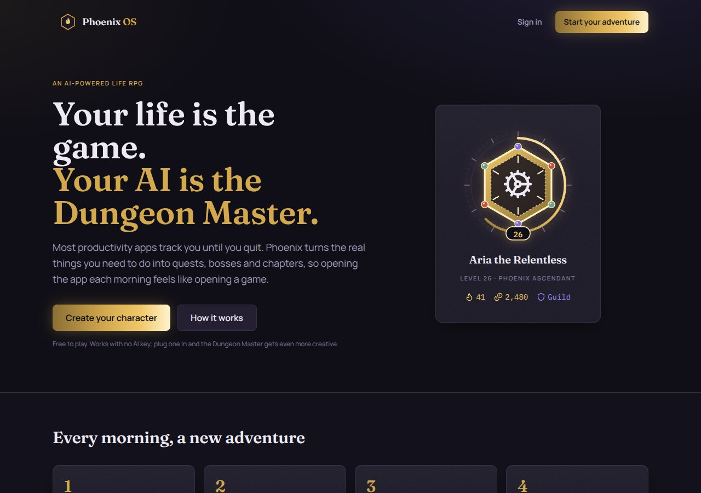
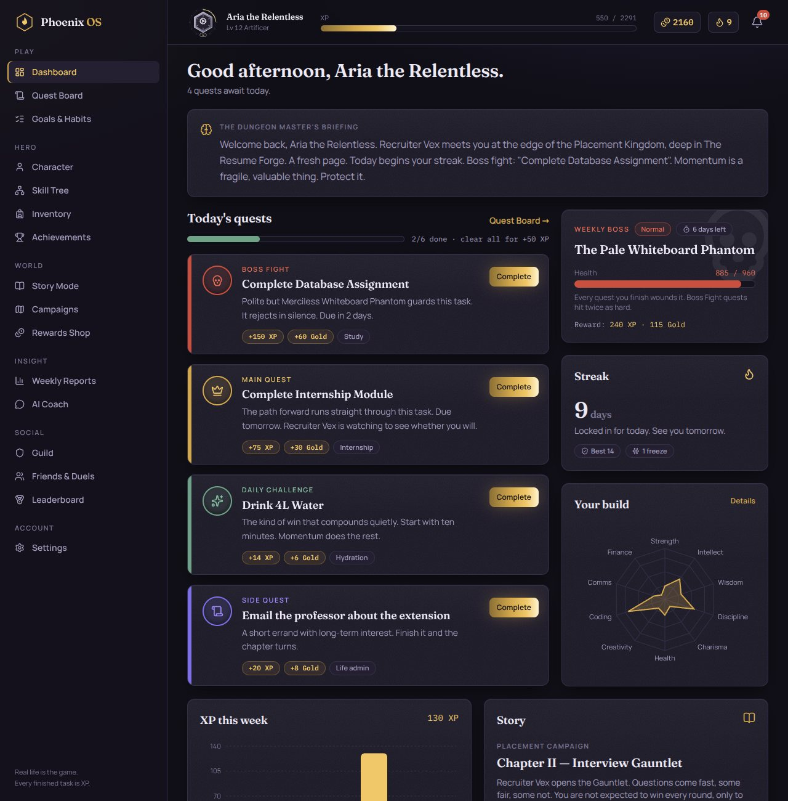
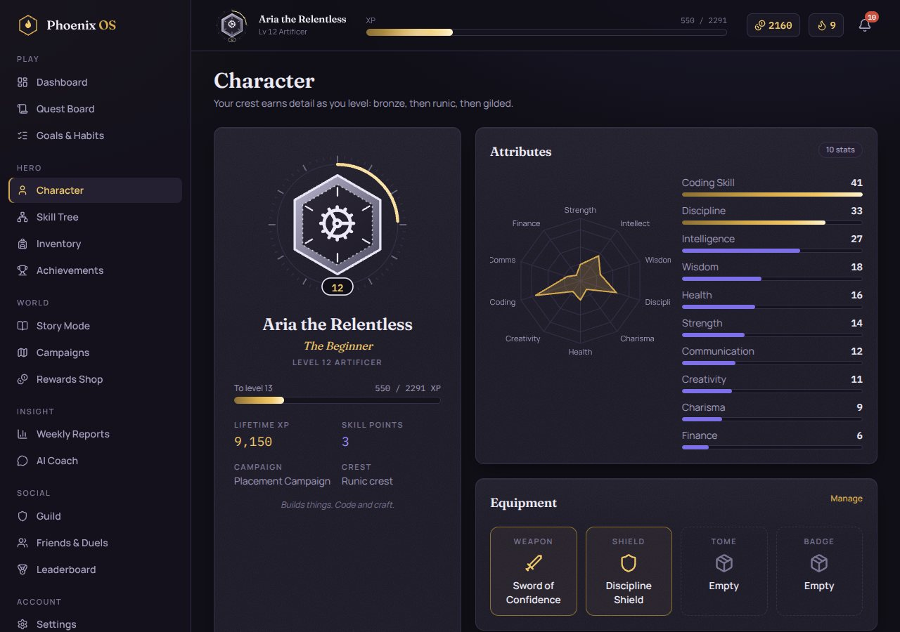
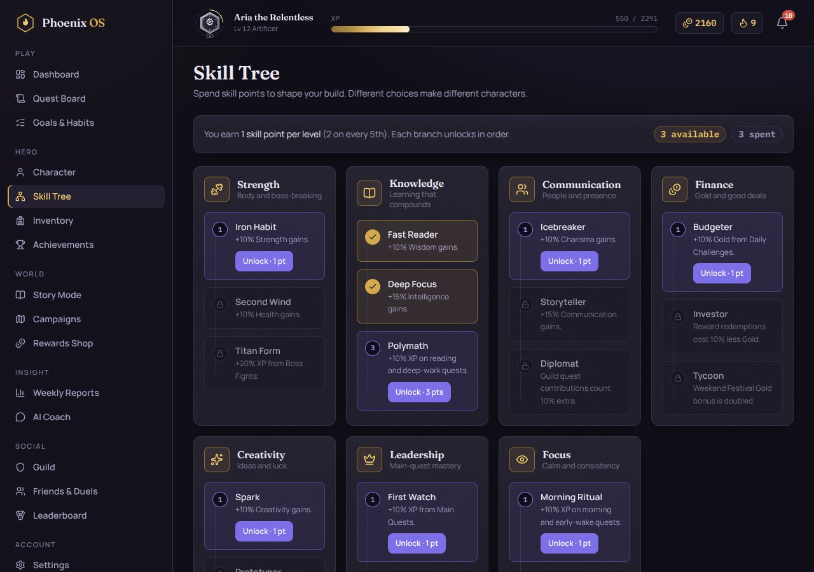
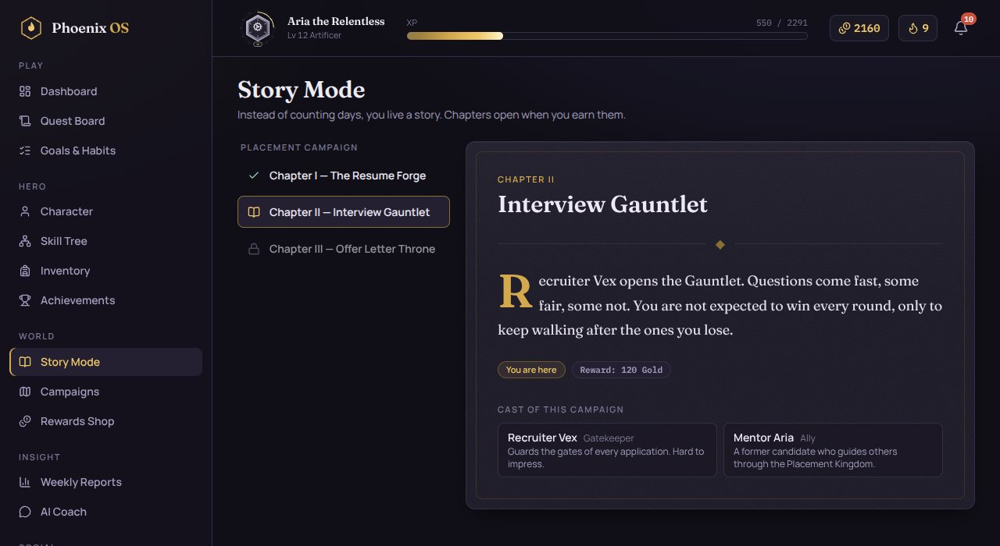
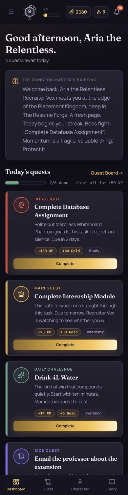
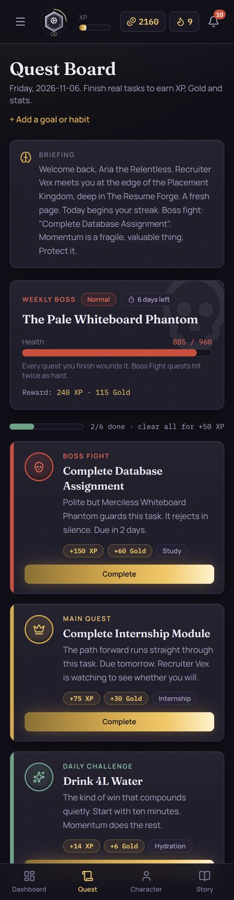

# Project Phoenix OS

**An AI-powered life RPG.** You tell the app what is actually on your plate (assignments, deadlines, habits). An AI *Dungeon Master* turns it into a fresh quest board every morning: a Main Quest, Side Quests, a Daily Challenge and a Boss Fight. Finishing real tasks earns XP, Gold and stat growth, advances a story, and levels up a character whose crest visibly gains detail as you progress.

Built exactly on the stack in the product spec: **Next.js 16 (App Router) · React 19 · TypeScript · Tailwind CSS · shadcn/ui-style components (Radix) · Framer Motion · Lucide · Recharts · Supabase (Postgres, Auth, RLS) · Vercel**, with optional **OneSignal, PostHog, Sentry**.

> **Works with zero AI keys.** A built-in offline Dungeon Master (hand-written quest, story, boss and coaching content with seeded variation) runs by default. Add an Anthropic, OpenAI or Gemini key (or run Ollama locally) and it upgrades automatically. If the AI ever fails, the offline engine takes over without the player noticing.

---

## Screenshots

Captured from the production build (headless Chromium) with a mid-game character.

| | |
|---|---|
|  |  |
|  |  |
|  |   |

---

## 1. What is in the box

| Spec phase | Delivered |
|---|---|
| **1 · MVP** | Auth (email + Google/GitHub/Apple buttons), character creation wizard (6 classes, 6 campaigns, focus stats, difficulty), daily quests, XP + leveling, streaks (with Streak Freeze), dashboard |
| **2 · AI & story** | Hybrid AI Dungeon Master (quests, daily briefing, bosses, weekly reports, coach), Story Mode (20 chapters, 8 NPCs), 13 achievements, inventory + equipment + titles, 10 character stats, weekly AI reports with charts |
| **3 · Depth** | Weekly boss battles with HP, 6 random events (Double XP, Secret Quest, Treasure Chest, Lucky Spin wheel, Hidden Boss, Weekend Festival), 6 campaigns, 21-node skill tree across 7 branches, synthesized sound effects, level-up/boss/chapter celebrations with confetti |
| **4 · Social & release** | Guilds (weekly pooled-XP guild quests), friends, 1v1 XP duels with Gold stakes, 3 leaderboards (this week / all time / guilds), AI coach chat, notifications (in-app + OneSignal push), PostHog analytics, Sentry monitoring, security headers, Vercel cron jobs, deployment docs |

Plus things the spec implied but did not spell out: a **Goals & Habits manager** (so the Dungeon Master has your *real* schedule to work with), a Gold **Rewards Shop** (spec prices: 500 / 1,000 / 3,000 / 5,000, plus your own rewards), a setup diagnostics page (`/setup`), and a runnable verification harness (`verification/`).

### Where the build deliberately differs from the spec
- **"Real-time synchronization"** (Supabase Realtime) is **not used**. Pages refresh after each action; there is no live push of other players' activity.
- **Supabase Storage** is not used: the character is a procedurally drawn crest, so there are no uploads.
- **Shared Boss Battles** are implemented as weekly **guild quests** (everyone's finished quests add to a shared XP pool). A literal multiplayer boss with one shared HP bar is not built.
- **Mindfulness**: the spec's example "Meditation → +Mindfulness" has no matching stat in its own list of ten attributes, so meditation grows Wisdom and Discipline.
- **Firebase vs OneSignal**: the spec allowed either; OneSignal is wired. **Tremor** is not used; Recharts covers all charts.
- Apple sign-in needs an Apple Developer account and Supabase configuration; the button is included but only appears if you list `apple` in `NEXT_PUBLIC_AUTH_PROVIDERS`.

---

## 2. Quick start (local)

**Prerequisites:** Node.js **20.9+** and a free [Supabase](https://supabase.com) project.

```bash
npm install
cp .env.example .env.local        # then fill in the three Supabase values (below)
npm run dev                       # http://localhost:3000
```

1. **Create a Supabase project.** In **SQL Editor**, run these two files, in order, once:
   - `supabase/migrations/0001_schema.sql`: 36 tables, row-level security, atomic game-state functions, leaderboards
   - `supabase/migrations/0002_seed.sql`: campaigns, 20 story chapters, NPCs, achievements, items, titles, skill tree
2. **Copy keys** from *Project Settings → API* into `.env.local`: `NEXT_PUBLIC_SUPABASE_URL`, `NEXT_PUBLIC_SUPABASE_ANON_KEY`, `SUPABASE_SERVICE_ROLE_KEY`.
3. **Auth redirect:** *Authentication → URL Configuration* → Site URL `http://localhost:3000`, and add `http://localhost:3000/auth/callback` to *Redirect URLs*. For quick local testing you can turn off *Confirm email* under *Providers → Email*.
4. Open `http://localhost:3000`, sign up, create your character, then open **Goals & Habits** and add something real.

Visit **`/setup`** at any time: it shows which variables are configured and which AI engine is active (`/api/health` returns the same as JSON).

**OAuth (Google / GitHub / Apple):** enable the provider in *Supabase → Authentication → Providers* (follow Supabase's per-provider guide), then list it in `NEXT_PUBLIC_AUTH_PROVIDERS`.

### npm scripts
`dev` · `build` · `start` · `typecheck` · `test` (26 unit tests, no database needed) · `verify`, `verify:integration`, `verify:smoke` (see §8).

---

## 3. Configuration

Everything is in `.env.example`, which documents each variable. Only the three Supabase values are required.

| Capability | Variables | Notes |
|---|---|---|
| **AI Dungeon Master** | `ANTHROPIC_API_KEY` *or* `OPENAI_API_KEY` *or* `GEMINI_API_KEY` | Auto-priority Anthropic → OpenAI → Gemini. Override with `DM_PROVIDER`. |
| Local AI (dev) | `DM_PROVIDER=ollama`, `OLLAMA_MODEL`, `OLLAMA_BASE_URL` | Uses Ollama's OpenAI-compatible endpoint. Never auto-selected. |
| Scheduled jobs | `CRON_SECRET` | Pre-generates quests and sends the morning/evening push notifications; builds weekly reports on Mondays. Optional: quests are also created lazily on first visit each day. |
| Push notifications | `NEXT_PUBLIC_ONESIGNAL_APP_ID`, `ONESIGNAL_REST_API_KEY` | In-app notifications always work. |
| Analytics | `NEXT_PUBLIC_POSTHOG_KEY` | Respects Do-Not-Track, no session recording, never sends task text. |
| Error monitoring | `NEXT_PUBLIC_SENTRY_DSN` (+ `SENTRY_AUTH_TOKEN/ORG/PROJECT` for source maps) | Disabled and silent without a DSN. `sendDefaultPii` is off. |

---

## 4. The AI Dungeon Master

`lib/ai/` contains the whole AI layer. Design rules worth knowing:

- **The model never sets rewards.** The LLM only *dresses* the day: it writes descriptions, invents filler quests, writes the briefing, boss, report and coach replies. XP, Gold and stat gains are computed by deterministic code (`lib/game/rewards.ts`) from quest type and tags, so no prompt, hallucination or hostile goal title can mint XP.
- **Your real tasks are never lost or renamed.** The engine decides which quests exist (every active goal, today's habits, plus fillers). The model's output is reconciled against that plan: unknown ids are discarded, counts and order are fixed by the engine, and a real task keeps your original wording as its title.
- **Untrusted text is treated as data.** Player-written text is length-limited, stripped of control characters, wrapped in a `<player_data>` block the system prompt declares untrusted, and model output is stripped of markdown/HTML before it is stored.
- **Safety.** If a coach message looks like a self-harm crisis, the message **never reaches a model**: the app answers with a fixed, supportive message that points to emergency services and trusted people.
- **Always available.** Any provider failure (HTTP error, timeout after ~25–30 s, invalid JSON) falls back to the offline engine for that call. The `source` of each quest/briefing/report is recorded (`ai` / `offline`).
- **No SDK lock-in.** Providers are plain `fetch` calls (Anthropic Messages API with forced tool-use for structured output; OpenAI-compatible Chat Completions for OpenAI/Gemini/Ollama).
- **Cost.** One quest call + one briefing call per player per day, one report per week, one call per coach message (capped at 40 per player per day).

**Data sent to your AI provider:** character name, level, stats, campaign, streak, goal/habit titles and notes, quest titles, and coach messages. Nothing else (no email, no user id).

---

## 5. How the game works (rules reference)

**Leveling.** XP to clear level *L* is `round(80 × L^1.35)`: 80 → 204 → … → 1,791 (L10) → 6,170 (L25). Reaching level 10 takes about 6,700 XP in total and level 25 about 62,600; at a steady ~250 XP/day that is roughly 27 days and 8 months. Each level grants 1 skill point (2 on every 5th).

**Quest rewards** (`lib/game/rewards.ts`). Base XP comes from the quest's tag, using the spec's table: Wake early 20 · Gym 50 · Deep work 80 · Reading 25 · Meditation 15 · Internship 60 · Coding practice 40 (plus Cardio 40, Study 60, Networking 35, Speaking 35, Hydration 15, Sleep 20, Finance 30, Creative 35, Writing 30, Life admin 20). Tags are inferred from your wording ("Solve 2 LeetCode problems" → Coding practice). Then ×type (Main 1.25, Side 1, Daily Challenge 0.9, **Boss Fight 2.5**), +2% per level (cap +40%), ×difficulty (Gentle 0.9 / Normal 1 / Hardcore 1.15). Gold = 40% of XP. Each tag also grows specific stats. Skill and gear bonuses and event multipliers are applied at completion time.

**Daily board.** Gentle ≈ 4 quests, Adventurer ≈ 5–6, Hardcore up to 8. Real tasks always win; the rest is filled from the campaign's quest library, steered toward your focus stats and your weakest stats, avoiding the last 7 days' titles. Clear a board of 3+ quests for a once-per-day bonus: +50 XP, +25 Gold, +2 Discipline.

**Streaks.** A day counts after your first completed quest. One missed day is covered by a **Streak Freeze** (you start with 1; earn another every 7 streak days, every ~4 with *Unshakeable*; max 3). Days are calendar days in *your* timezone.

**Weekly boss.** HP `(900 + 60 × level) × difficulty` (Normal 1, Hard 1.4, Very hard 1.9, Legendary 2.6). Every finished quest deals damage equal to its XP (double for Boss Fight quests). Defeat it for 25% of its HP as XP, 12% as Gold, and item drops on harder bosses. It flees after 7 days; a new one arrives. Every 8th boss is Legendary.

**Random events** (rolled once per day on first visit): weekday 20% chance of something happening; weekend 35% (adds Weekend Festival: +50% Gold). Double XP 6% · Secret Quest 5% · Treasure Chest 5% (+75 Gold) · Lucky Spin 3% · Hidden Boss 1%. The *Visionary* skill shifts 10 points of probability toward events.

**Skill tree.** 7 branches × 3 tiers (Strength, Knowledge, Communication, Finance, Creativity, Leadership, Focus). Tiers unlock in order. Effects are real: stat bonuses, XP bonuses by quest type or tag, Gold bonuses, reward discounts (capped at 50%), better streak-freeze regeneration, more random events.

**Story.** 5 chapters on the general path (the spec's Chapter I–V) and 3 each on Fitness, Placement, Startup, UPSC and Exam campaigns. A chapter opens when its criteria are met (streak, stat threshold or level) and only after the previous one; opening the next chapter completes the previous. Chapters can pay Gold and items.

**Social.** Guilds hold up to 30 members; the weekly guild quest target is 1,200 XP per member; everyone claims 300 XP + 100 Gold once it is complete. Duels last 1–14 days, stakes (≤ 500 Gold) are held in escrow when accepted, the winner takes the pot, a draw refunds both.

---

## 6. Architecture

```
app/                      Next.js App Router
  (game)/…                 16 authenticated pages (dashboard, quests, tasks, character, skills, inventory,
                           achievements, story, campaigns, rewards, reports, coach, guild, friends, leaderboard, settings)
  api/…                    23 JSON route handlers (+ /auth/callback, /auth/signout); cron/* are secret-protected
proxy.ts                  Next 16 "proxy" (renamed middleware): refreshes the Supabase session and gates private routes
lib/game/                 Pure game rules: XP curve, rewards, effects, streaks, events, bosses, skills, criteria  (unit-tested)
lib/ai/                   Dungeon Master: offline engine + LLM transports + hybrid orchestrator + sanitizers
lib/server/               Services that touch the database: player, daily rollover, quests, actions, social, reports, cron
lib/supabase/             Browser / server / admin clients and the session proxy
components/               UI primitives (shadcn-style), game components (crest, quest board, skill tree, …), layout
supabase/migrations/      0001_schema.sql (tables, RLS, RPCs) · 0002_seed.sql (game content)
verification/             Optional local test harness (see §8)
```

**Key design decisions**
- **Server-authoritative game state.** The browser can read its own rows but cannot write XP, Gold, level, quests, inventory or anything competitive: those tables have no write policy. Every mutation goes through an API route that verifies the session, then uses the service-role key scoped to *that* player. (A player can still freely edit their own goals, habits and custom rewards.)
- **Atomic, race-proof progress.** XP/Gold/stats/streak change through one compare-and-set Postgres function, so two quests completed in the same instant cannot overwrite each other; the quest status flip is the idempotency gate; the all-clear bonus, boss defeats and guild/duel payouts each have an atomic once-only gate.
- **Everything is on a ledger.** Every XP and Gold change writes `xp_log` / `gold_transactions`. The invariant "lifetime XP = XP ledger, Gold = 100 + Gold ledger" is asserted for every player in the integration suite.
- **Lazy daily rollover.** The first request of a player's day generates the board (one request wins a lock; others wait for it), expires missed quests, and spawns or retires bosses. Cron merely pre-warms it.
- **Next 16 specifics.** `proxy.ts` instead of `middleware.ts`; `cookies()` is awaited; Turbopack builds; React 19.

---

## 7. Deploy to Vercel

1. Push the project to GitHub and **Import** it in Vercel (framework is auto-detected).
2. **Environment variables** (Production *and* Preview): the three Supabase values, `NEXT_PUBLIC_SITE_URL=https://your-domain`, and any optional ones. `NEXT_PUBLIC_*` values are baked in at build, so set them before the first deploy.
3. **Supabase → Authentication → URL Configuration:** set *Site URL* to your domain and add `https://your-domain/auth/callback` to *Redirect URLs* (add a wildcard for preview deployments if you use them).
4. **Cron:** `vercel.json` already schedules `/api/cron/morning` (01:30 UTC) and `/api/cron/evening` (14:30 UTC). Set `CRON_SECRET`; Vercel sends it as a bearer token automatically. Each call handles `?limit=` (default 100, max 200) players from `?offset=`; for larger audiences add more cron entries with different offsets.
5. Deploy, then open `/setup` on the live site: every required row should be green.

---

## 8. Verification: what was actually tested

All of the following were run against this exact code.

| Layer | Result |
|---|---|
| Dependencies | `npm audit`: **0 vulnerabilities** (Next 16.4.3, React 19, zod 4, Sentry 10.76.1 with patched transitive deps) |
| Type safety | `tsc --noEmit` clean (strict) · `next build` (Turbopack) succeeds with no warnings |
| **Unit tests** (`npm test`) | **26 pass**: XP curve, rewards, effects, streaks (freeze/break), events (probabilities), bosses, skills, criteria, timezones, offline Dungeon Master, LLM transports (mocked `fetch`), prompt-injection reconciliation, every fallback path, provider selection |
| **Database security** | Real Postgres 16: users cannot read others' rows, cannot write their own level/Gold, cannot call privileged functions |
| **Integration** (`verify:integration`) | **15 scenarios pass** against real Postgres + PostgREST: race conditions (6 simultaneous completions), multi-day simulation with an injected clock, every random event, boss defeat exactly once, guild/duel flows, cron, and the XP/Gold **ledger invariant** |
| **Production smoke** (`verify:smoke`) | **44 checks pass** against `next start`: every page renders for a signed-in player, `proxy.ts` redirects, 401/409/400/403 behaviour, CSRF origin check, cron auth, security headers |
| Visual review | Every page was rendered in headless Chromium and reviewed at desktop width, and the key pages (dashboard, quest board, character) at phone width; defects found that way (coach message order, mobile quest-card layout, plural grammar, raw tag names in skill text) were fixed |

**Not verified (be aware):** it was not run against a *hosted* Supabase project (the harness uses PostgREST + a GoTrue stand-in), so real OAuth providers, email confirmation, and Supabase's own rate limits are untested. **No live LLM call** was made: the Anthropic/OpenAI/Gemini/Ollama request formats are implemented to each provider's documented API and tested with mocked responses, and any failure falls back to offline. OneSignal push, PostHog and Sentry delivery were not exercised. The Gemini default model id (`gemini-3.8-flash`) came from Google's compatibility docs; change `GEMINI_MODEL` if it has moved. There was no load or accessibility-audit tooling; screen-reader labels, focus rings, reduced-motion handling and keyboard operation are implemented but not audited.

---

## 9. Security & privacy notes

- Row-level security on every table; the browser role is read-only for game state. The service-role key exists only on the server (`lib/supabase/admin.ts` is `server-only`).
- Every API route validates input with zod, checks the session, and re-derives the player from the session; cross-site POSTs are rejected (origin check, plus SameSite cookies); cron endpoints use a timing-safe secret comparison and refuse all requests when no secret is set.
- Security headers (`nosniff`, `X-Frame-Options: DENY`, referrer and permissions policies) are set in `next.config.mjs`.
- **Not included / suggested before a public launch:** global rate limiting (e.g. Vercel WAF or Upstash), a Content-Security-Policy with nonces, CAPTCHA on sign-up, account-deletion UI (deleting a user in Supabase cascades through all game data), and an abuse/moderation path for guild names.

---

## 10. Troubleshooting

- **Redirected to `/setup`:** one of the three Supabase variables is missing (restart `npm run dev` after editing `.env.local`).
- **"Create your character first" / bounced to `/onboarding`:** expected for a new account; finish the wizard.
- **Login works but pages error:** the migrations were not run (or `0002_seed.sql` was skipped). Run both files in order.
- **OAuth returns to `/login?error=auth`:** the redirect URL `…/auth/callback` is not in Supabase's allowed list, or the provider isn't enabled.
- **Cron returns 401:** `CRON_SECRET` is unset or doesn't match the bearer token.
- **Quests don't look AI-written:** check `/api/health` → `dungeonMaster`. `offline` means no key was detected; `hybrid(llm:… → offline)` means an AI is active (a quest shows an **AI** badge when it was written by the model).
- **Wrong day / streak rolls at the wrong time:** set your timezone in Settings (the wizard captures it from your browser).

---

## 11. Ideas for later

Supabase Realtime for live guild/duel updates · a literal shared-HP guild boss · seasonal leaderboards with resets · avatar uploads via Supabase Storage · calendar import so the Dungeon Master can read your real schedule · installable PWA with offline quest completion · an admin/moderation console.
